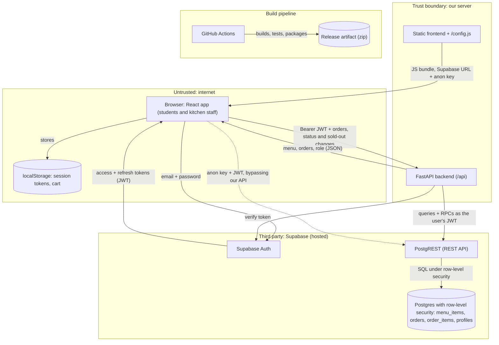

# Threat model -- Pub-Order (Group 5)   (docs/security/threat-model.md)
Last updated: 2026-11-03 · Authors: Brink Wiesedeppe, Hamayun Raza, Luke Anderson, Ibrahim Boudaoud · Covers: main @ `12b0d43` (no staging deployment yet: the app runs locally or from the release artifact, against the hosted Supabase project)

## 1. Data-flow diagram (DFD)
Subgraphs are trust zones; every arrow between zones crosses a trust boundary. Pub-Order has no LLM, payment or email provider, so the only third party is Supabase.

### Trust boundaries
| # | Boundary (A -> B) | Data crossing it | Who controls each side |
|---|-------------------|------------------|------------------------|
| B1 | Browser -> FastAPI | Bearer JWT, cart and order JSON, kitchen status and sold-out changes | User controls the browser; we control the API |
| B2 | Browser -> Supabase Auth | Email, password; returns access and refresh tokens | User / Supabase |
| B3 | FastAPI -> Supabase Auth | The user's access token, to verify it | Us / Supabase |
| B4 | FastAPI -> PostgREST -> Postgres | Queries and `place_order` / `set_order_status` / `set_item_availability` calls, as the user's JWT | Us / Supabase (our migrations define the rules) |
| B5 | Browser -> PostgREST directly | Anon key (public, in `/config.js`) + the user's JWT | User / Supabase. The app never does this, but anyone signed in can. |
| B6 | GitHub Actions -> release artifact | Source, third-party actions and packages -> built zip | GitHub and action authors / us |

## 2. Assets (what an attacker wants)
| Asset | Where it lives | Why it matters | Impact if lost or changed |
|-------|----------------|----------------|---------------------------|
| Student accounts / sessions | Supabase Auth; tokens in browser localStorage | Whoever holds a session can place and read that student's orders | M |
| Kitchen role (staff access) | `profiles.role` in Postgres; shared `kitchen@puborder.test` account | Sees every order, changes any order status, marks items sold out | H |
| Order history | `orders`, `order_items` | What each student ordered and when; tampering confuses pickup | M |
| Menu availability | `menu_items.available` | Marking items sold out blocks every student from ordering them | M |
| Kitchen order queue | `orders` (status Received) | Flooding it stops real orders being made | M |
| Supabase anon key | `.env`, `/config.js`, browser | Public by design; safe only because row-level security is correct | L |
| Supabase service-role key | Supabase dashboard; local test runs only (never in the repo or CI secrets) | Bypasses all row-level security: full database control | H |
| Release artifact / CI | GitHub Actions, workflow artifacts | A tampered build would ship to whoever runs it | M |

There is no LLM budget, payment data or real meal-plan balance in the system today.

## 3. STRIDE table (at least 8 rows, across at least 3 boundaries)
| # | Boundary (A -> B) | STRIDE | Asset | Threat (one sentence) | Existing control | Gap? -> Finding ID |
|---|-------------------|--------|-------|-----------------------|------------------|--------------------|
| T1 | Browser -> Supabase Auth (B2) | S | Student accounts | Someone signs up with another student's email (or any email) and orders in their name, because the hosted project does not confirm emails. | None; sign-up accepts any address | Yes -> SEC-02 |
| T2 | Browser -> Supabase Auth -> Postgres (B2, B4) | E | Kitchen role | The `handle_new_user` trigger makes whoever signs up as `kitchen@puborder.test` kitchen staff, so on any project where that account doesn't exist yet (a new staging deploy, or after it is deleted) the first person to register it gets full staff access. | Roles are only writable inside the database; students can't edit `profiles` | Yes -> SEC-01 |
| T3 | Browser -> FastAPI (B1) | E | Kitchen role | A student calls `PATCH /orders/{id}` or `PATCH /menu/{id}` directly to change a status or mark an item sold out. | `require_kitchen` in the API and `is_kitchen()` inside the database functions; tested (`test_a_student_cannot_change_an_order_status`, `roles.sql`) | No |
| T4 | Browser -> FastAPI -> Postgres (B1, B4) | I | Order history | A student changes the order id in `GET /orders/{id}` to read another student's order (IDOR). | Row-level security returns only the student's own rows; the API answers 404; tested (`test_another_student_cannot_track_the_order`) | No |
| T5 | Browser -> PostgREST (B5) | T | Kitchen order queue | A student calls `place_order` directly with the public anon key, skipping the API's checkout review and its customization allow-list, and sends free-text "customizations" to the kitchen. | `place_order` re-checks items, quantities and the meal rule; customization is cut to 200 characters; React escapes it on screen | Yes -> SEC-06 |
| T6 | Browser -> FastAPI / PostgREST (B1, B5) | D | Kitchen order queue | A signed-in script places hundreds of valid orders, flooding the kitchen queue, since nothing limits orders per student or per minute. | Each order is capped at 10 swipes; nothing else | Yes -> SEC-03 |
| T7 | Browser -> FastAPI (B1) | R | Order history, menu availability | A staff member denies changing an order's status or marking an item sold out, and we can't show who did it: the kitchen login is shared and only `updated_at` is stored. | `updated_at` timestamp only | Yes -> SEC-04 |
| T8 | FastAPI -> Supabase Auth (B3) | S | Student accounts | An attacker sends a forged or expired JWT to the API to act as another user. | `get_current_user` verifies every token with Supabase Auth; tested (`test_token_with_tampered_signature_is_rejected`) | No |
| T9 | Browser storage (B2) | I | Student and kitchen sessions | Any script injected into the page could read the Supabase tokens from localStorage and take over the session. | React escapes all output; no `dangerouslySetInnerHTML`, `innerHTML` or `eval`; no Content-Security-Policy or other security headers | Yes -> SEC-05 |
| T10 | Browser -> FastAPI (B1) | I | Database details | A database or network error leaks table names or connection details in the API response. | Every database error becomes a short 503 message; tested (`test_database_failures_are_sanitized`) | No |
| T11 | Browser -> FastAPI (B1) | T | Order history | Kitchen staff (or a stolen kitchen session) moves an order backwards, e.g. Collected -> Received, confusing pickup. | Only kitchen accounts can change status; any transition is allowed | Yes -> SEC-07 |
| T12 | GitHub Actions -> artifact (B6) | T | Release artifact | A compromised third-party action changes the build, because actions are pinned to version tags, not commit SHAs. | Python packages pinned with `==`, `package-lock.json` committed, no secrets in CI | Yes -> SEC-08 |

## 4. OWASP Top 10:2025 checklist -- owner per category
With four members and ten categories, two members take three. Results are filled in during the Sprint 4 manual review.

| Category | Owner | What we checked (where) | Result: pass / finding (ID) / N/A + reason |
|----------|-------|-------------------------|--------------------------------------------|
| A01 Broken Access Control (try changing an ID as another user) | Brink | Change order ids as a second student on every `/orders` route; call kitchen routes and RPCs as a student; row-level security on every table | To do (threat model: T3, T4 controlled) |
| A02 Security Misconfiguration | Hamayun | CORS origins in `main.py`; security headers from `serve.py`; Supabase Auth settings (email confirmation); default accounts | To do (SEC-02, SEC-05 suspected) |
| A03 Software Supply Chain Failures | Hamayun | `pip-audit`, `npm audit --audit-level=high`, gitleaks over the whole history, GitHub Actions pinning | To do (SEC-08 suspected) |
| A04 Cryptographic Failures | Ibrahim | Passwords handled by Supabase Auth; HTTPS to Supabase; no secrets in URLs or logs; `.env` is gitignored | To do |
| A05 Injection (SQL, XSS, command) | Luke | No string-built SQL (PostgREST and parameterized PL/pgSQL); no raw HTML rendering; customization text | To do |
| A06 Insecure Design | Brink | Abuse cases from STRIDE: order flooding, free-text customizations, any-direction status changes | To do (SEC-03, SEC-06, SEC-07 suspected) |
| A07 Authentication Failures | Luke | Token expiry and refresh, sign-out, sign-up and login rate limits, user enumeration in sign-in errors, shared kitchen login | To do (SEC-01, SEC-02 suspected) |
| A08 Software or Data Integrity Failures | Brink | CI actions pinned, no secrets readable from fork PRs, release built only from main / `sprint3*` tags | To do (SEC-08 suspected) |
| A09 Security Logging & Alerting Failures | Ibrahim | Are failed sign-ins, 401/403 responses and kitchen changes logged (without tokens)? The backend has no logging today | To do (SEC-04 suspected) |
| A10 Mishandling of Exceptional Conditions | Hamayun | `except Exception` blocks in `orders.py` / `menu.py`; role lookup failing open or closed (`fetch_role`); error pages | To do |

## 5. Top 3 risks and next actions
1. **SEC-01: kitchen access is granted by email address (T2, High).** Remove the `kitchen@puborder.test` rule from `handle_new_user`, grant kitchen only by a database-side update that a student can't trigger, and add a regression test that registering that email produces a student. Owner: Brink.
2. **SEC-02: sign-up doesn't verify who you are (T1, Medium).** Turn on email confirmation for the hosted project and limit sign-up to `@vanderbilt.edu` addresses (Auth setting or a check in the sign-up trigger), with a test that another domain is refused. Owner: Luke.
3. **SEC-03: no limit on orders per student (T6, Medium).** Cap how many open (Received / Preparing) orders one student can have inside `place_order`, plus a rate limit on `POST /orders`, with a test that the extra order is refused. Owner: Ibrahim.

Each becomes a GitHub issue labelled `security` in the Sprint 4 milestone.
